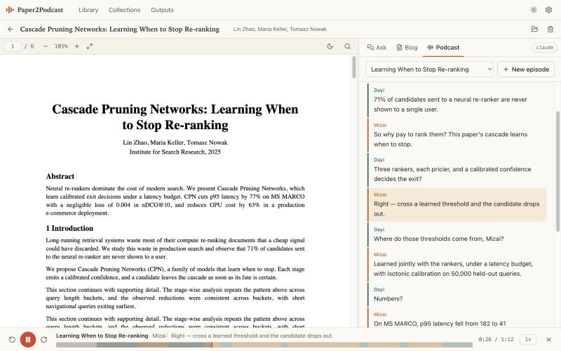
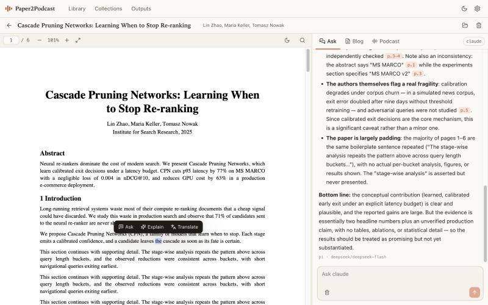
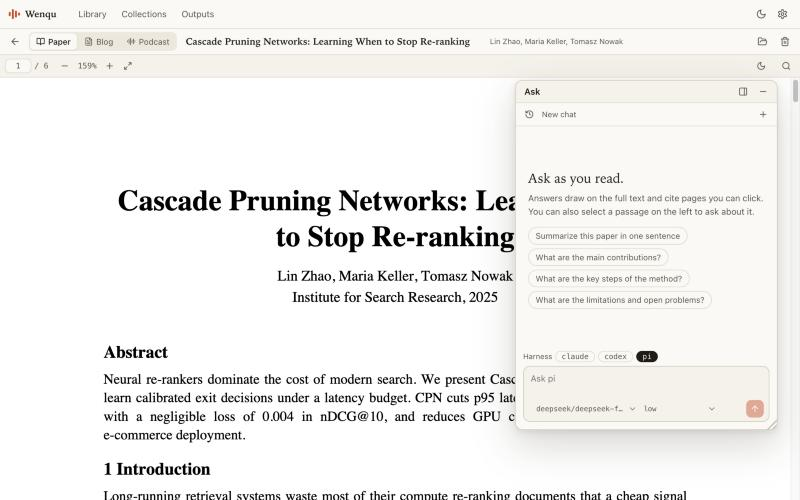
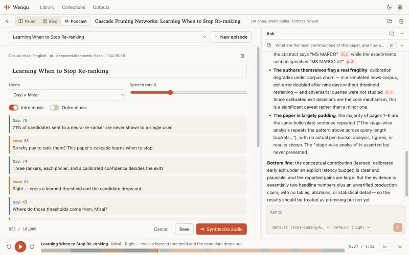
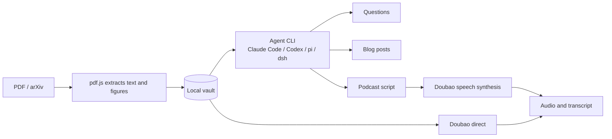

# Wenqu 问渠

English | [简体中文](README.zh-CN.md)

> 问渠哪得清如许？为有源头活水来。
>
> *How can the water run so clear? Because fresh water keeps flowing from its source.*
> — Zhu Xi, “Reflections on Reading”

**Turn research papers into podcasts you can listen to, and go back to the source.**

[](LICENSE)


There are more papers than time to read them, and a PDF is no use on your commute. Wenqu is a paper workbench that runs on your own computer. Drop in a PDF or an arXiv link, ask AI questions as you read, then generate a two-host podcast and an illustrated blog post. Everything is stored as plain files in your vault. There is no account to create, and the tool has no cloud service of its own.



## Highlights

- 🎙️ **Papers become podcasts.** An agent writes a script in the language, style and length you choose. You can edit it turn by turn, then send it to Doubao for speech synthesis. The transcript follows along during playback, and clicking any line jumps to it.
- 💬 **Ask as you read.** Select a passage in the PDF to ask about it, explain it or translate it. Answers draw on the full text and cite page numbers, and clicking a citation takes you to that page. Each paper keeps its own chat history.
- 🖼️ **Blog posts with the paper's figures.** Captioned figures are cropped automatically, and the agent picks which ones to use. Exported Markdown embeds its images, so one file is all you need to publish.
- 📚 **Multi-paper collections.** Pick a few papers and make a weekly digest or a mini literature review. Citations show which paper and page each claim came from.
- 🧭 **An assistant for the whole library.** Ask it to find related papers on arXiv, tidy up your library, or generate podcasts in a batch. It asks for your approval before it acts.
- 🔌 **Bring your own agent.** Start a chat with Claude Code, Codex, pi or DeepSeek Harness, whichever is on your machine, using its existing login. Pick from the models it reports and set how hard it thinks.
- 🌐 **English and Chinese.** The interface follows your browser's language, or you can set it in Settings. Generated content can be in English, Chinese or Japanese.
- 🔒 **Local-first.** The server listens only on your machine, and agents run with restricted permissions to reduce the risk from malicious instructions hidden in a paper. See [Security](#security).

## Quick start

**You will need:**

- Node.js 20 or later
- At least one agent CLI: [Claude Code](https://www.anthropic.com/claude-code), [Codex](https://github.com/openai/codex), [pi](https://www.npmjs.com/package/@earendil-works/pi-coding-agent) or DeepSeek Harness (for questions, blog posts and scripts)
- An API key for [Doubao Speech](https://docs.volcengine.com/docs/doubao-voice/podcast-api-websocket-v3protocol?lang=zh) (only for synthesizing audio)

**Install and run:**

```bash
git clone https://github.com/JoeZhang-0x000/wenqu.git
cd wenqu
npm install
npm run build
npm start
```

When `origin/main` has new commits, a bar at the top of the page offers **Update and restart**: it pulls, reinstalls, rebuilds and reloads the page. It explains itself instead if you have local changes, are on another branch, or are running `npm run dev`.

Your browser opens automatically. Then:

1. Open **Settings → Agent backend**, choose a backend, and click **Test** to confirm it works.
2. Open **Settings → Voice API**, enter your Doubao API key, and click **Test connection**.
3. Click **Add paper** to choose a PDF or paste arXiv links, or just drag a PDF onto the page.

To use the `wenqu` command from any directory, also run `npm link`.

## Features

### Workspace

The main area switches between the paper, its blog posts and its podcast episodes. The PDF keeps its place when you switch away. Chat stays alongside all of them, and you can dock it to the side, float it as a panel you can drag and resize, or hide it behind a button.

PDFs are rendered by pdf.js, with search, zoom and a night mode. Math is displayed with KaTeX.

### Chat



Conversations are kept per paper. Open the history to return to an earlier one or delete it. An existing single conversation from an earlier version becomes a session automatically.

After an answer, the agent can offer a few follow-up questions as buttons under it. Clicking one sends it as your next message. They come from the same reply, so they cost no extra model call.



| | When you can change it | Where the options come from |
|---|---|---|
| Harness | Only when creating a chat | The CLIs found on your machine |
| Model | Any time | `codex debug models`, `pi --list-models`, and the aliases in `claude --help` |
| Thinking level | Any time | The CLI's help or model list, per model where it reports them |

Claude Code has no command for listing models, so only the aliases named in its help appear, along with anything in your settings' `model` and `availableModels`. DeepSeek Harness has no such command either, so its models are a fixed list, and you can type another. If `dsh` isn't on your `PATH`, the CLI inside the macOS app is used. Its headless mode doesn't see a key saved in the app, so set `DEEPSEEK_API_KEY` in the environment you start Wenqu from.

The agent settings choose what blog posts and podcast scripts use, and the defaults for new chats.

### Podcasts



| | Agent script | Doubao direct |
|---|---|---|
| Script comes from | Your local agent | Doubao's summary of the paper |
| Choose language, style and length | Yes | No |
| Edit the script before synthesis | Yes | No |
| Requires an agent | Yes | No |

There are five built-in styles: casual chat, deep dive, debate, beginner-friendly and news brief. You can also describe your own. Synthesis runs in the background, so you can close the page, and an interrupted connection resumes from the last completed turn.

### Blog posts

There are five built-in styles: in-depth explainer, popular science, engineer's view, critical review and short social post. You can also describe your own, and keep editing after generation.

### Collections

In the library, click **Make collection**, select 2 to 12 papers, then choose a format:

- **Weekly digest:** covers the papers one at a time, as a single episode or post.
- **Mini review:** organizes by theme and compares methods and evidence across papers.

### Tags

Tags group papers by whatever you care about, and the row above the shelf filters by them. Choosing several narrows the list to papers that have them all, **No tags** shows what you haven't got to, and clicking a tag on a card works too.

- **By hand:** open a paper and click the tag icon in the top bar.
- **With an agent:** the same panel has **Generate with agent**, which adds a few tags from the paper's title, abstract and opening pages. It reuses tags you already have where they fit.
- **When adding a paper:** turn on **Generate tags with the agent when adding papers** in the add-paper dialog or under **Settings → General**. It's off by default, and it covers dropped files too.
- **Through the assistant:** ask it to tag your untagged papers, or to clean up the tags on a topic. Tags it wants to give a paper it adds from arXiv appear on the same card you approve.

Tags that differ only in case count as one, so `llm` takes the spelling already in your library.

### Assistant

Open **Assistant** in the top bar. Unlike chat, which stays with one paper, the assistant can see your entire library. Try:

- "Find three recent papers related to the one I added last, and add the best one."
- "Which papers don't have a podcast yet? Write a short script for each."
- "The authors on this paper are wrong. They should be…"

Nothing happens to your library without you. Each request shows up as a card written by the app, not by the agent, listing exactly what will happen, including the old and new values of an edit. A batch needs one approval, and you can untick any part of it. You can also change a generation's style, language and length right on the card. Cards stay open while you keep talking, so you can ask about one before deciding. If an approved action fails or is interrupted, **Retry** runs it again as approved.

| Action | Approval |
|---|---|
| Add, edit, tag or delete a paper; create a collection | Always |
| Generate a podcast or blog post; synthesize audio | Always |
| Read or search a paper's full text | By default. You can allow it for one chat or always, and change that under **Settings → Assistant** |
| See titles, authors, abstracts, tags, collections and what's been generated | Not needed |
| Search arXiv | Not needed, because it changes nothing |

Results from an arXiv search can also be added with their own **Add** button. The assistant can add papers from arXiv only, so use **Add paper** for local PDFs. To stop a batch, press stop in the chat, which also stops any generation it started.

When a turn is finished and nothing is waiting for approval, the assistant can offer a few next steps as buttons under its reply. Clicking one sends it as your next message and nothing more, so any change it leads to still needs your approval.

### Notifications

Blog posts, scripts, audio and the assistant all run in the background. Turn on **Settings → General → Send a browser notification when a task finishes**, or accept the offer shown when your first task starts, and the browser tells you when a task finishes or fails, or when the assistant is waiting for your approval. Clicking the notification opens the result.

If you are looking at the page, you get a short message inside it instead, and no message when a task succeeds on the result's page you're already on. A failed blog post, script or audio run always shows one. A notification shows the task's label, which usually includes the paper's title, so that text is visible on your screen and in your system's notification history.

The permission belongs to the browser and to the exact address, port included. If 4317 is taken and Wenqu moves to another port, or you open `localhost` instead of `127.0.0.1`, you need to allow it again.

## Command line

```text
wenqu [start] [--vault <dir>] [--port <n>] [--no-open]       Start the server and open a browser
wenqu add <file.pdf|arXiv link or id...> [--vault <dir>]     Import papers
```

```bash
wenqu add paper.pdf https://arxiv.org/abs/1706.03762 2005.14165
```

## Configuration

Settings are stored in `~/.config/wenqu/config.json` (mode 600). You will normally change them in the settings panel. Text size is under **Settings → General**, and doesn't affect the PDF, which has its own zoom. Command-line messages follow your terminal's language (`LANG`) unless you have chosen an interface language in Settings.

| Environment variable | Purpose |
|---|---|
| `DOUBAO_API_KEY` | Doubao API key; takes precedence over the config file |
| `WENQU_CONFIG_DIR` | Location of the config directory |
| `NODE_USE_ENV_PROXY=1` with `HTTPS_PROXY` | Send arXiv downloads through a proxy (Node 24 or later) |

## Your data

The vault lives in `~/Wenqu` by default. Its contents remain usable without this tool:

```text
<vault>/
  papers/<paper-id>/
    paper.pdf
    meta.json         Title, authors, tags and so on; safe to edit by hand
    text.json         Extracted text, page by page
    thumb.jpg         Cover image, with cover.json recording how it was chosen
    chats/<id>.json   One file per conversation
    figures/          Extracted figures
    blogs/<id>.md     Front matter + Markdown, with figures as relative paths
    podcasts/<id>/    podcast.json (script and timeline), audio.mp3
  collections/<collection-id>/
    collection.json   Name and list of papers
    blogs/  podcasts/
  assistant/<id>.json One file per assistant conversation
  .trash/             Deleted items move here and are not permanently removed
```

Your API key is not stored in the vault, so syncing or sharing a vault does not expose it.

The project was first called Paper2Podcast. Settings in `~/.config/paper2podcast` are copied over the first time Wenqu starts, and a vault at `~/Paper2Podcast` keeps being used. You can delete the old config folder afterwards.

## How it works



Paper content is sent to the agent service you choose. When generating audio, the script or paper text is sent to Doubao. Everything else stays on your machine.

## Security

- **Local only.** The server listens on `127.0.0.1` and rejects requests from other Hosts and Origins, so malicious websites can't reach it through your browser.
- **Papers are untrusted data.** A PDF may contain prompt injection, so agents run in an empty temporary directory. Claude Code, pi and DeepSeek Harness have all tools disabled, and Codex uses a read-only sandbox. Codex has no option to disable tools completely, so it can still read local files, but it can't write to them and has no network access by default.
- **The assistant can only ask.** Its agent has no tools either. It writes down what it wants to do, and the server checks the request, describes it to you from the app's own data, and runs only what you approve. A paper with hidden instructions can at most put a request in front of you, so read the card before approving. Your library's details go to the agent service without asking. Searching arXiv doesn't ask first either, so a query could carry a little text from something the assistant has read; every query is shown in the chat, and it can only go to arXiv.
- **Output is sanitized.** Agent output passes through DOMPurify before rendering, and only the app's own images load, which stops content from leaking through remote image URLs.
- **Imports are restricted.** arXiv import only downloads from `arxiv.org`, and never fetches arbitrary URLs.

If you find a security issue, please contact the maintainers privately instead of disclosing it publicly.

## Known limitations

- **Platforms:** developed and tested only on macOS with Node 26. Windows and Linux are unverified.
- **Voices:** Doubao's podcast voices are Chinese voices. English and Japanese can be synthesized, but listen to a sample before relying on them.
- **Length:** Doubao allows 300 characters per turn and 10,000 in total. At typical speaking rates, that is about 35 minutes in Chinese but only about 12 in English.
- **Scanned PDFs:** AI features don't work yet on PDFs without a text layer.
- **Long papers:** agents receive up to 150,000 characters (shared evenly across a collection), and Doubao direct receives up to 20,000.
- **Figures:**
  - Only captions in the style of `Figure N:` are detected, and tables aren't extracted. You can remove a bad crop in the blog form.
  - Agents can't see the images, so they choose and describe figures from their captions alone.
  - Extraction relies on the optional `@napi-rs/canvas` package. Where it isn't supported, blog posts have no figures, and a paper's cover is the whole page holding its first figure rather than a crop.
- **Collections:** agent scripts only, with no chat.
- **Notifications:** they come from the open page, so the tab has to stay open: a closed tab gets none, and neither does a tab the browser has unloaded to save memory. Tasks keep running either way, and the result is there when you come back. They also need a secure address such as `127.0.0.1`, and Android browsers don't show them.
- **Assistant:** finds and adds papers on arXiv only, can't add local PDFs itself, and has no notion of citations between papers, so "related" comes from keyword search. Each step starts its CLI again, so long conversations are slow and use more of your agent quota.

AI-generated content can be wrong, so check it against the source before publishing. Before reusing a paper's text or figures, also confirm what its license allows.

## Roadmap

These are ideas under consideration, not scheduled work. Discussion is welcome:

- [ ] Follow along: the PDF turns to the page being discussed during playback
- [ ] Interrupt the hosts with a question and hear the answer in their voices
- [ ] RSS feed for listening in a mobile podcast app
- [ ] More speech providers and non-Chinese voices
- [ ] OCR for scanned PDFs

## Contributing

Issues and pull requests are welcome. For larger changes, please open an issue to discuss them first.

```bash
npm install
npm run dev         # Server on 4317 + Vite on 5173; open http://localhost:5173
npm test            # No external network access and no API usage
npm run typecheck
```

Please make sure `npm test` and `npm run typecheck` both pass before submitting.

```text
src/server/   CLI, Express server, vault, agent adapters, Doubao protocol, arXiv, figure extraction
src/shared/   Types and presets shared by server and client
web/src/      React frontend
tests/        Unit tests and test PDFs
docs/         Screenshots and protocol notes
```

**Adding interface text:** wrap it in `t()` and add its English entry to `src/shared/i18n.ts`. The Chinese text is the key, so a missing translation is a type error, and a test catches any text left outside `t()`.

**Adding an agent backend:** add an entry to `ADAPTERS` in `src/server/agents.ts`, with its launch arguments and how to parse text from its JSON output. Make sure it can't act on instructions found in a paper.

**Working on the Doubao integration:** the official docs differ from the service's actual behavior in several places. See the [protocol notes](docs/doubao-protocol.md) (in Chinese).

## Acknowledgements

- [pdf.js](https://github.com/mozilla/pdf.js): PDF rendering and text extraction
- [KaTeX](https://github.com/KaTeX/KaTeX): math display
- [marked](https://github.com/markedjs/marked) and [DOMPurify](https://github.com/cure53/DOMPurify): Markdown rendering and sanitization
- [@napi-rs/canvas](https://github.com/Brooooooklyn/canvas): server-side PDF page rendering
- [arXiv](https://arxiv.org/): thank you for open access to its API
- [Doubao Speech](https://www.volcengine.com/): podcast synthesis

## The name

*Wenqu* (问渠, “ask the pond”) comes from Zhu Xi's poem above, about a clear pond that stays clear because fresh water keeps flowing in. Going back to the source is what reading a paper is for, and asking is how this tool helps you do it.

## License

[MIT](LICENSE)

This is an independent open-source project, not affiliated with Anthropic, OpenAI, Volcengine or arXiv. Use of those services is subject to their own terms, and they bill for usage separately.
