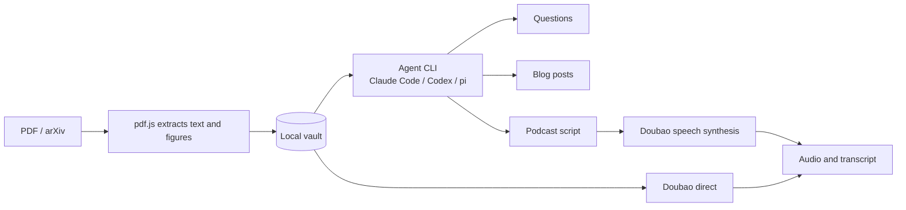

# Paper2Podcast

English | [简体中文](README.zh-CN.md)

**Turn research papers into podcasts you can listen to.**

[](LICENSE)


There are more papers than time to read them, and a PDF is no use on your commute. Paper2Podcast is a paper workbench that runs on your own computer. Drop in a PDF or an arXiv link, ask AI questions as you read, then generate a two-host podcast and an illustrated blog post. Everything is stored as plain files in your vault. There is no account to create, and the tool has no cloud service of its own.


## Highlights

- 🎙️ **Papers become podcasts.** An agent writes a script in the language, style and length you choose. You can edit it turn by turn, then send it to Doubao for speech synthesis. The transcript follows along during playback, and clicking any line jumps to it.
- 💬 **Ask as you read.** Select a passage in the PDF to ask about it, explain it or translate it. Answers draw on the full text and cite page numbers, and clicking a citation takes you to that page.
- 🖼️ **Blog posts with the paper's figures.** Captioned figures are cropped automatically, and the agent picks which ones to use. Exported Markdown embeds its images, so one file is all you need to publish.
- 📚 **Multi-paper collections.** Pick a few papers and make a weekly digest or a mini literature review. Citations show which paper and page each claim came from.
- 🔌 **Bring your own agent.** Switch between Claude Code, Codex and pi, using each one's existing login.
- 🌐 **English and Chinese.** The interface follows your browser's language, or you can set it in Settings. Generated content can be in English, Chinese or Japanese.
- 🔒 **Local-first.** The server listens only on your machine, and agents run with restricted permissions to reduce the risk from malicious instructions hidden in a paper. See [Security](#security).

## Quick start

**You will need:**

- Node.js 20 or later
- At least one agent CLI: [Claude Code](https://www.anthropic.com/claude-code), [Codex](https://github.com/openai/codex) or [pi](https://www.npmjs.com/package/@earendil-works/pi-coding-agent) (for questions, blog posts and scripts)
- An API key for [Doubao Speech](https://docs.volcengine.com/docs/doubao-voice/podcast-api-websocket-v3protocol?lang=zh) (only for synthesizing audio)

**Install and run:**

```bash
git clone <repository-url> paper2podcast
cd paper2podcast
npm install
npm run build
npm start
```

Your browser opens automatically. Then:

1. Open **Settings → Agent backend**, choose a backend, and click **Test** to confirm it works.
2. Open **Settings → Voice API**, enter your Doubao API key, and click **Test connection**.
3. Drag a PDF onto the page, or paste an arXiv link.

To use the `paper2podcast` command from any directory, also run `npm link`.

## Features

### Reading and questions


PDFs are rendered by pdf.js, with search, zoom and a night mode. Math is displayed with KaTeX.

### Podcasts


| | Agent script | Doubao direct |
|---|---|---|
| Script comes from | Your local agent | Doubao's summary of the paper |
| Choose language, style and length | Yes | No |
| Edit the script before synthesis | Yes | No |
| Requires an agent | Yes | No |

There are five built-in styles: casual chat, deep dive, debate, beginner-friendly and news brief. You can also describe your own. Synthesis runs in the background, so you can close the page, and an interrupted connection resumes from the last completed turn.

### Blog posts

There are five built-in styles: in-depth explainer, popular science, engineer's view, critical review and short social post. You can also describe your own, and keep editing after generation.

### Collections

In the library, click **Make collection**, select 2 to 12 papers, then choose a format:

- **Weekly digest:** covers the papers one at a time, as a single episode or post.
- **Mini review:** organizes by theme and compares methods and evidence across papers.

## Command line

```text
paper2podcast [start] [--vault <dir>] [--port <n>] [--no-open]       Start the server and open a browser
paper2podcast add <file.pdf|arXiv link or id...> [--vault <dir>]     Import papers
```

```bash
paper2podcast add paper.pdf https://arxiv.org/abs/1706.03762 2005.14165
```

## Configuration

Settings are stored in `~/.config/paper2podcast/config.json` (mode 600). You will normally change them in the settings panel. Command-line messages follow your terminal's language (`LANG`) unless you have chosen an interface language in Settings.

| Environment variable | Purpose |
|---|---|
| `DOUBAO_API_KEY` | Doubao API key; takes precedence over the config file |
| `P2P_CONFIG_DIR` | Location of the config directory |
| `NODE_USE_ENV_PROXY=1` with `HTTPS_PROXY` | Send arXiv downloads through a proxy (Node 24 or later) |

## Your data

The vault lives in `~/Paper2Podcast` by default. Its contents remain usable without this tool:

```text
<vault>/
  papers/<paper-id>/
    paper.pdf
    meta.json         Title, authors and so on; safe to edit by hand
    text.json         Extracted text, page by page
    chat.json         Question history
    figures/          Extracted figures
    blogs/<id>.md     Front matter + Markdown, with figures as relative paths
    podcasts/<id>/    podcast.json (script and timeline), audio.mp3
  collections/<collection-id>/
    collection.json   Name and list of papers
    blogs/  podcasts/
  .trash/             Deleted items move here and are not permanently removed
```

Your API key is not stored in the vault, so syncing or sharing a vault does not expose it.

## How it works



Paper content is sent to the agent service you choose. When generating audio, the script or paper text is sent to Doubao. Everything else stays on your machine.

## Security

- **Local only.** The server listens on `127.0.0.1` and rejects requests from other Hosts and Origins, so malicious websites can't reach it through your browser.
- **Papers are untrusted data.** A PDF may contain prompt injection, so agents run in an empty temporary directory. Claude Code and pi have all tools disabled, and Codex uses a read-only sandbox. Codex has no option to disable tools completely, so it can still read local files, but it can't write to them and has no network access by default.
- **Output is sanitized.** Agent output passes through DOMPurify before rendering, and only the app's own images load, which stops content from leaking through remote image URLs.
- **Imports are restricted.** arXiv import only downloads from `arxiv.org`, and never fetches arbitrary URLs.

If you find a security issue, please contact the maintainers privately instead of disclosing it publicly.

## Known limitations

- **Platforms:** developed and tested only on macOS with Node 26. Windows and Linux are unverified.
- **Voices:** Doubao's podcast voices are Chinese voices. English and Japanese can be synthesized, but listen to a sample before relying on them.
- **Length:** Doubao allows 300 characters per turn and 10,000 in total. At typical speaking rates, that is about 35 minutes in Chinese but only about 12 in English.
- **Scanned PDFs:** AI features don't work yet on PDFs without a text layer.
- **Long papers:** agents receive up to 150,000 characters (shared evenly across a collection), and Doubao direct receives up to 20,000.
- **Figures:**
  - Only captions in the style of `Figure N:` are detected, and tables aren't extracted. You can remove a bad crop in the blog form.
  - Agents can't see the images, so they choose and describe figures from their captions alone.
  - Extraction relies on the optional `@napi-rs/canvas` package. Where it isn't supported, blog posts have no figures.
- **Collections:** agent scripts only, with no question answering.

AI-generated content can be wrong, so check it against the source before publishing. Before reusing a paper's text or figures, also confirm what its license allows.

## Roadmap

These are ideas under consideration, not scheduled work. Discussion is welcome:

- [ ] Follow along: the PDF turns to the page being discussed during playback
- [ ] Interrupt the hosts with a question and hear the answer in their voices
- [ ] RSS feed for listening in a mobile podcast app
- [ ] More speech providers and non-Chinese voices
- [ ] OCR for scanned PDFs

## Contributing

Issues and pull requests are welcome. For larger changes, please open an issue to discuss them first.

```bash
npm install
npm run dev         # Server on 4317 + Vite on 5173; open http://localhost:5173
npm test            # No external network access and no API usage
npm run typecheck
```

Please make sure `npm test` and `npm run typecheck` both pass before submitting.

```text
src/server/   CLI, Express server, vault, agent adapters, Doubao protocol, arXiv, figure extraction
src/shared/   Types and presets shared by server and client
web/src/      React frontend
tests/        Unit tests and test PDFs
docs/         Screenshots and protocol notes
```

**Adding interface text:** wrap it in `t()` and add its English entry to `src/shared/i18n.ts`. The Chinese text is the key, so a missing translation is a type error, and a test catches any text left outside `t()`.

**Adding an agent backend:** add an entry to `ADAPTERS` in `src/server/agents.ts`, with its launch arguments and how to parse text from its JSON output. Make sure it can't act on instructions found in a paper.

**Working on the Doubao integration:** the official docs differ from the service's actual behavior in several places. See the [protocol notes](docs/doubao-protocol.md) (in Chinese).

## Acknowledgements

- [pdf.js](https://github.com/mozilla/pdf.js): PDF rendering and text extraction
- [KaTeX](https://github.com/KaTeX/KaTeX): math display
- [marked](https://github.com/markedjs/marked) and [DOMPurify](https://github.com/cure53/DOMPurify): Markdown rendering and sanitization
- [@napi-rs/canvas](https://github.com/Brooooooklyn/canvas): server-side PDF page rendering
- [arXiv](https://arxiv.org/): thank you for open access to its API
- [Doubao Speech](https://www.volcengine.com/): podcast synthesis

## License

[MIT](LICENSE)

This is an independent open-source project, not affiliated with Anthropic, OpenAI, Volcengine or arXiv. Use of those services is subject to their own terms, and they bill for usage separately.
