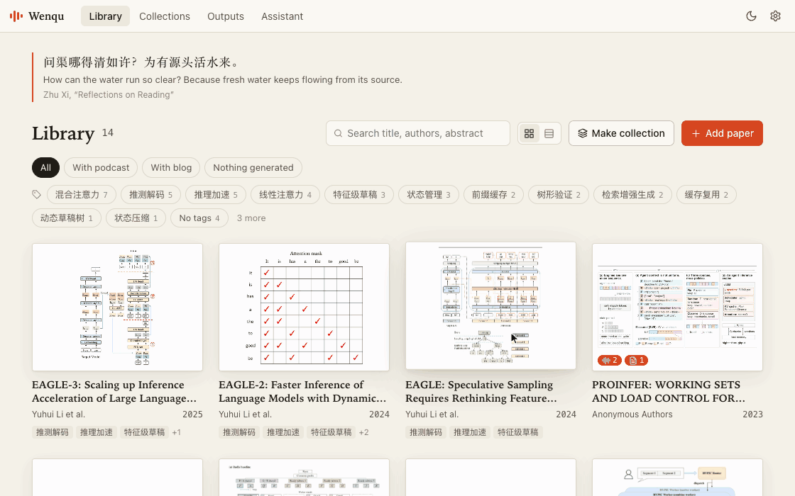
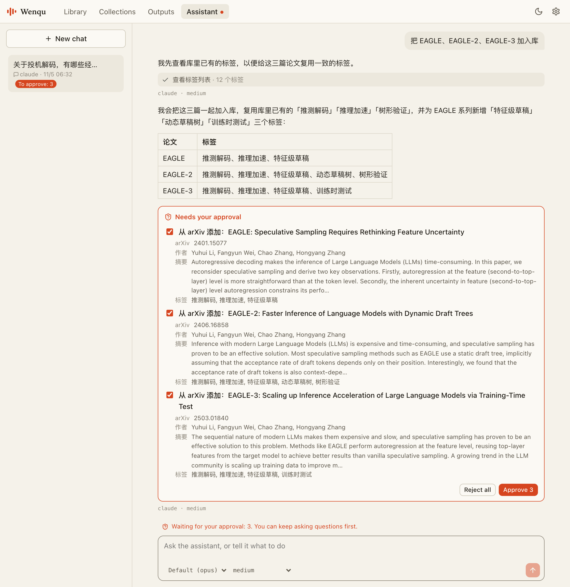
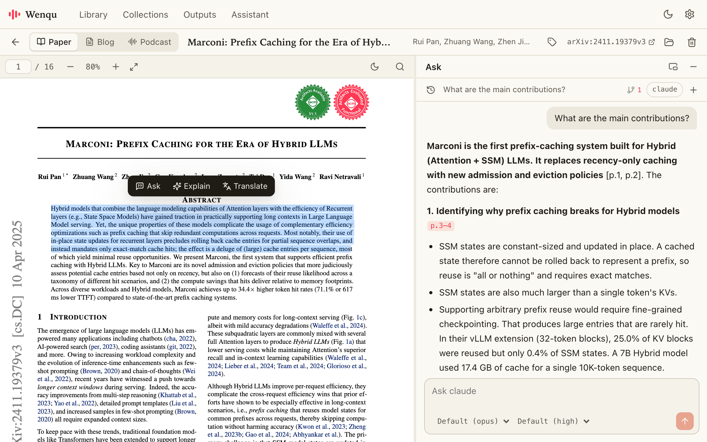
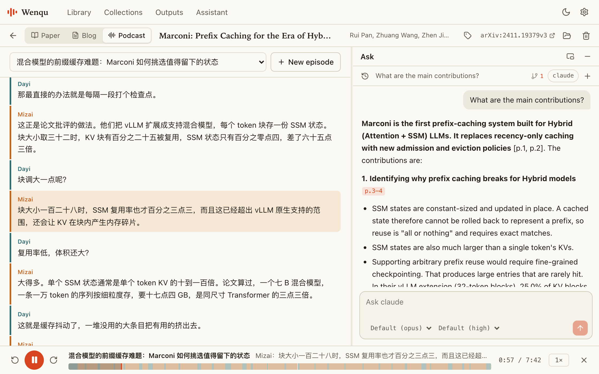

# Wenqu 问渠

English | [简体中文](README.zh-CN.md)

> 问渠哪得清如许？为有源头活水来。
>
> *How can the water run so clear? Because fresh water keeps flowing from its source.*
> — Zhu Xi, “Reflections on Reading”

[](LICENSE)


The number of papers keeps growing, and reading each one closely takes blocks of time that research and engineering also need.

Wenqu turns papers into podcasts you can listen to at any time, so reading no longer has to happen at a desk. A commute, a workout or a round of chores is enough to get through a paper.

**Wenqu is a lightweight, local, intelligent assistant for your papers.**

<p>
  <b>Supported backends</b>&nbsp;&nbsp;
  <a href="https://claude.com/product/claude-code"> Claude Code</a>&nbsp;&nbsp;
  <a href="https://openai.com/codex/"> Codex</a>&nbsp;&nbsp;
  <a href="https://pi.dev/"><picture><source media="(prefers-color-scheme: dark)" srcset="docs/images/backends/pi-dark.svg"></picture> pi</a>&nbsp;&nbsp;
  <a href="https://www.deepseek.com/en/harness/"> DeepSeek Harness</a>
</p>



## What it does

### Manage: a steward for your shelf



An agent-native paper library. It finds papers, keeps the shelf in order, and writes reviews.

### Ask: wherever you are on the page



Select a passage to ask about it. Answers draw on the full text, cite the page, and can be checked against the paper's code.

### Listen: wherever you are in the day



A paper becomes a two-host podcast. Edit the script line by line, and follow the transcript as it plays.

## Quick start

**You will need:**

- Node.js 20 or later
- At least one agent CLI: [Claude Code](https://claude.com/product/claude-code), [Codex](https://openai.com/codex/), [pi](https://pi.dev/) or [DeepSeek Harness](https://www.deepseek.com/en/harness/) (for questions, blog posts and scripts)
- An API key for [Doubao Speech](https://docs.volcengine.com/docs/doubao-voice/podcast-api-websocket-v3protocol?lang=zh) (only for synthesizing audio)

**Install and run:**

```bash
git clone https://github.com/JoeZhang-0x000/wenqu.git
cd wenqu
npm install
npm run build
npm start
```

Your browser opens automatically. Then:

1. Open **Settings → Agent backend**, choose a backend, and click **Test** to confirm it works.
2. Open **Settings → Voice API**, enter your Doubao API key, and click **Test connection**.
3. Click **Add paper** to choose a PDF or paste arXiv links, or just drag a PDF onto the page.

To use the `wenqu` command from any directory, also run `npm link`.

Everything else, from collections and tags to configuration and where your files live, is in the [guide](docs/guide.md).

## Security

- **Local only.** The server listens on `127.0.0.1`, so other websites can't reach it through your browser.
- **Papers are treated as untrusted.** Agents run in an empty temporary directory with restricted permissions, so instructions hidden in a PDF can't change your files.
- **You approve every change.** The assistant can only ask. The app shows exactly what will happen, and runs it when you say so.
- **Your files stay yours.** Papers, chats and episodes are plain files in your vault, and your API key is stored outside it. Paper content goes only to the agent service you chose, and to Doubao when you synthesize audio.

The details are in the [guide](docs/guide.md#security). If you find a security issue, please contact the maintainers privately instead of disclosing it publicly.

## Known limitations

- Developed and tested on macOS so far.
- Podcast voices come from Doubao and are Chinese voices. English and Japanese can be synthesized too.
- Scanned PDFs without a text layer aren't supported yet.
- Code reading works with GitHub repositories.
- AI-generated content can be wrong, so check it against the source before publishing.

The full list is in the [guide](docs/guide.md#known-limitations).

## Contributing

Issues and pull requests are welcome. Development notes are in the [guide](docs/guide.md#development).

## The name

*Wenqu* (问渠, “ask the pond”) comes from Zhu Xi's poem above, about a clear pond that stays clear because fresh water keeps flowing in. Going back to the source is what reading a paper is for, and asking is how this tool helps you do it.

## License

[MIT](LICENSE)

Wenqu is built and maintained by aetherheart.
