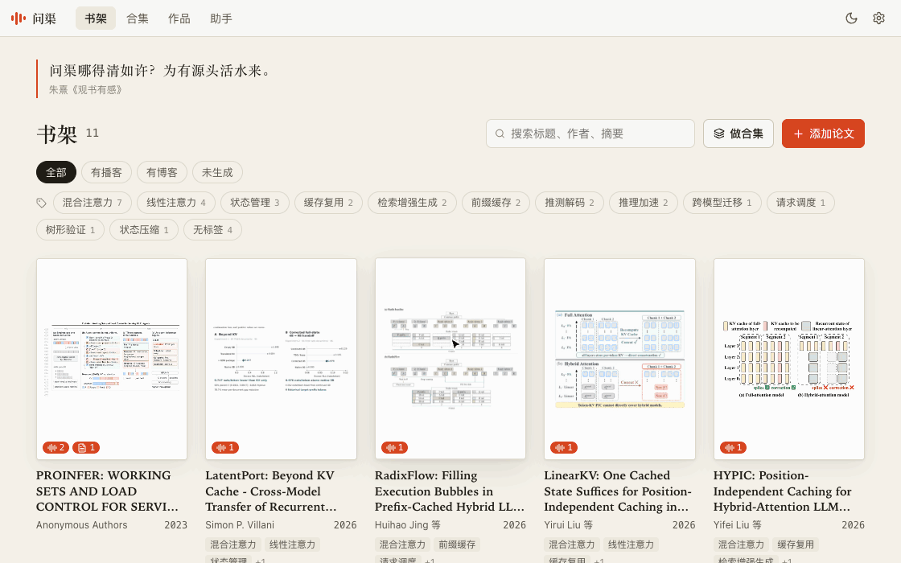
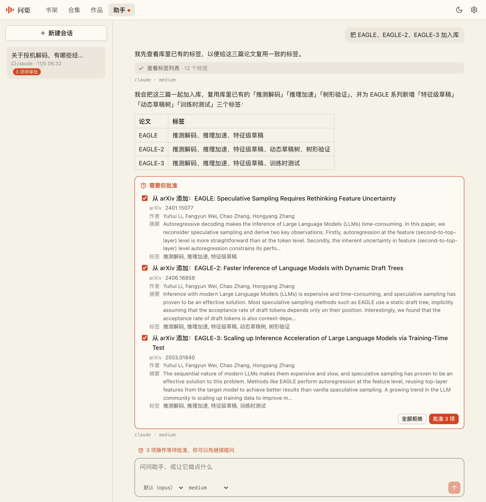
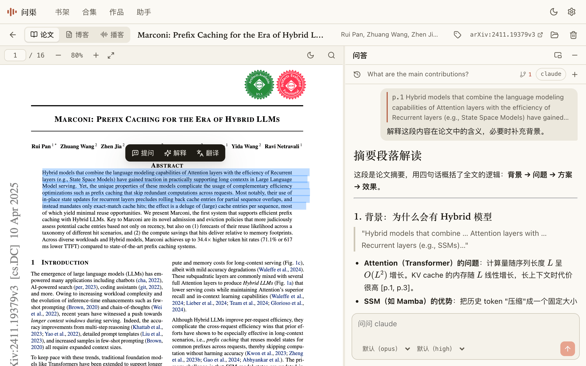
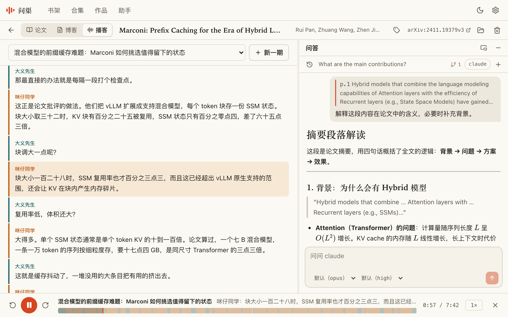

# 问渠 Wenqu

[English](README.md) | 简体中文

> 问渠哪得清如许？为有源头活水来。
>
> —— 朱熹《观书有感》

[](LICENSE)


论文数量持续增长，逐篇精读需要大量整块时间，往往与研究、开发等工作相互挤占。

问渠将论文转化为可随时收听的播客，让文献阅读不再局限于书桌前：通勤、运动、处理杂务时，都能听完一篇论文。

**问渠是一个轻量的本地化智能文献管理助手。**

<p>
  <b>支持的后端</b>&nbsp;&nbsp;
  <a href="https://claude.com/product/claude-code"> Claude Code</a>&nbsp;&nbsp;
  <a href="https://openai.com/codex/"> Codex</a>&nbsp;&nbsp;
  <a href="https://pi.dev/"><picture><source media="(prefers-color-scheme: dark)" srcset="docs/images/backends/pi-dark.svg"></picture> pi</a>&nbsp;&nbsp;
  <a href="https://www.deepseek.com/en/harness/"> DeepSeek Harness</a>
</p>



## 能做什么

### 管：找得到，理得清



Agent 原生管理论文库。检索文献，整理书架，撰写综述。

### 问：读到哪，问到哪



选中原文即可提问。回答基于全文，引用精确到页，并可对照论文关联的代码仓库。

### 听：走到哪，听到哪



将论文生成双人对谈播客。脚本可逐句修订，播放时字幕同步。

## 快速开始

**你需要：**

- Node.js 20 或更高版本
- 至少一个 Agent CLI：[Claude Code](https://claude.com/product/claude-code)、[Codex](https://openai.com/codex/)、[pi](https://pi.dev/) 或 [DeepSeek Harness](https://www.deepseek.com/en/harness/)（问答、写博客、写脚本时需要）
- [豆包语音](https://docs.volcengine.com/docs/doubao-voice/podcast-api-websocket-v3protocol?lang=zh)的 API Key（只有合成音频时需要）

**安装并启动：**

```bash
git clone https://github.com/JoeZhang-0x000/wenqu.git
cd wenqu
npm install
npm run build
npm start
```

浏览器会自动打开。接下来：

1. 在「设置 → Agent 后端」选择后端，并点「测试」确认可用。
2. 在「设置 → 语音 API」填入豆包的 API Key，并点「测试连接」。
3. 点击**添加论文**，选择本地 PDF 或粘贴 arXiv 链接；也可以直接把 PDF 拖进页面。

想在任意目录使用 `wenqu` 命令，可以再运行 `npm link`。

合集、标签、配置、文件存放位置等其余内容，见[使用手册](docs/guide.zh-CN.md)。

## 安全

- **只在本机。** 服务只监听 `127.0.0.1`，其他网站无法通过你的浏览器访问它。
- **论文按不可信数据处理。** Agent 在空的临时目录里以受限权限运行，PDF 里藏的指令改不了你的文件。
- **每处改动都由你批准。** 助手只能提出请求，应用会列出具体要做什么，你同意后才执行。
- **文件始终是你的。** 论文、对话和产出都是 Vault 里的普通文件，API Key 存在 Vault 之外。论文内容只会发给你所选的 Agent 服务，以及合成音频时的豆包。

细节见[使用手册](docs/guide.zh-CN.md#安全)。如果发现安全问题，请私下联系维护者，不要公开披露。

## 已知限制

- 目前只在 macOS 上开发和测试。
- 播客音色来自豆包，是中文音色，也可以合成英文和日文。
- 暂不支持没有文字层的扫描版 PDF。
- 阅读代码支持 GitHub 仓库。
- AI 生成的内容可能有误，发布前请对照原文核对。

完整列表见[使用手册](docs/guide.zh-CN.md#已知限制)。

## 参与开发

欢迎提交 Issue 和 Pull Request。开发说明见[使用手册](docs/guide.zh-CN.md#开发)。

## 名字的由来

“问渠”出自朱熹的《观书有感》：池塘之所以清澈，是因为有源头活水不断流入。读论文正是回到知识的源头，而提问就是这个工具帮你做的事。

## 许可证

[MIT](LICENSE)

问渠由 aetherheart 开发和维护。
