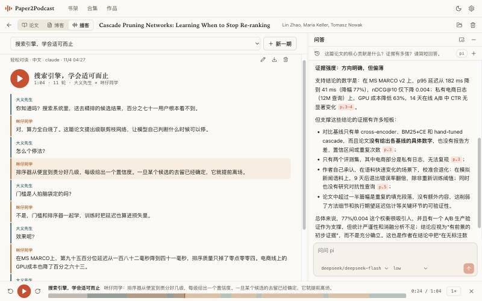
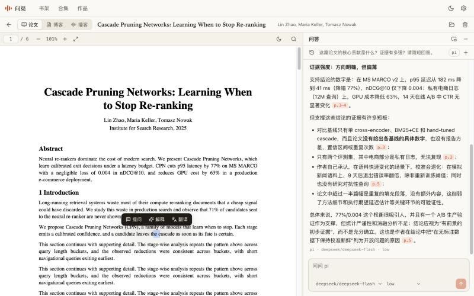
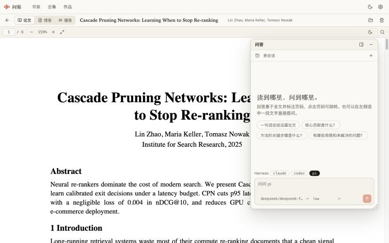
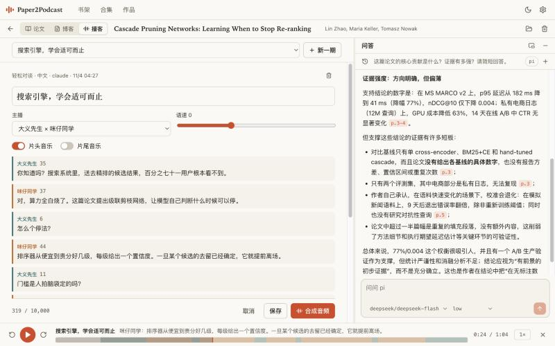
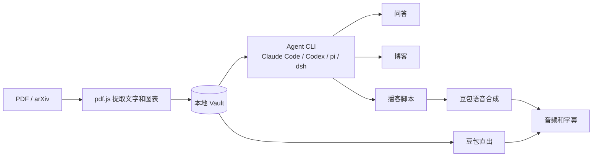

# 问渠 Wenqu

[English](README.md) | 简体中文

> 问渠哪得清如许？为有源头活水来。
>
> —— 朱熹《观书有感》

**把论文变成一期能听的播客，也让你随时回到源头。**

[](LICENSE)


论文读不完，通勤路上又看不了 PDF。问渠是一个运行在你电脑上的论文工作台：丢进一篇 PDF 或 arXiv 链接，边读边问 AI，再生成双人对谈的播客和带图的博客。所有内容都是你 Vault 里的普通文件。这个工具不需要注册账号，也没有自己的云端服务。



## 亮点

- 🎙️ **论文变播客。** Agent 按你选的语言、风格和时长写脚本，你可以逐轮修改，再交给豆包语音合成。播放时字幕同步，点任意一句就能跳过去。
- 💬 **读到哪，问到哪。** 在 PDF 里选中一段文字，直接提问、解释或翻译。回答基于全文并标注页码，点击页码就跳到原文。每篇论文都保留自己的会话历史。
- 🖼️ **博客自带论文图表。** 自动裁出带图注的图表，由 Agent 挑选插入。导出的 Markdown 内嵌图片，一个文件就能发布。
- 📚 **多篇合集。** 选几篇论文，做成一期「本周论文」或一篇小型综述。引用会标明出自哪篇的哪一页。
- 🧭 **管理整个书架的助手。** 让它在 arXiv 上找相近的论文、整理书架，或者批量生成播客。动手之前都会先征得你的同意。
- 🔌 **用你已有的 Agent。** 新建问答时从本机已安装的 Claude Code、Codex、pi 和 DeepSeek Harness 中选择，直接使用它们各自的登录状态。模型列表由它们自己提供，思考强度也可以调。
- 🌐 **中英双语。** 界面默认跟随浏览器语言，也可以在设置里指定。生成的内容可以是中文、英文或日文。
- 🔒 **本地优先。** 服务只监听本机，Agent 在受限权限下运行，以降低论文里恶意指令的风险。详见[安全](#安全)。

## 快速开始

**你需要：**

- Node.js 20 或更高版本
- 至少一个 Agent CLI：[Claude Code](https://www.anthropic.com/claude-code)、[Codex](https://github.com/openai/codex)、[pi](https://www.npmjs.com/package/@earendil-works/pi-coding-agent) 或 DeepSeek Harness（问答、写博客、写脚本时需要）
- [豆包语音](https://docs.volcengine.com/docs/doubao-voice/podcast-api-websocket-v3protocol?lang=zh)的 API Key（只有合成音频时需要）

**安装并启动：**

```bash
git clone https://github.com/JoeZhang-0x000/wenqu.git
cd wenqu
npm install
npm run build
npm start
```

`origin/main` 有新提交时，页面顶部会出现提示和**更新并重启**按钮，点击后会拉取代码、重新安装、重新构建并刷新页面。如果本地有改动、不在 main 分支，或正在运行 `npm run dev`，则只说明无法更新的原因。

浏览器会自动打开。接下来：

1. 在「设置 → Agent 后端」选择后端，并点「测试」确认可用。
2. 在「设置 → 语音 API」填入豆包的 API Key，并点「测试连接」。
3. 点击**添加论文**，选择本地 PDF 或粘贴 arXiv 链接；也可以直接把 PDF 拖进页面。

想在任意目录使用 `wenqu` 命令，可以再运行 `npm link`。

## 功能

### 工作区

主屏幕在论文、博客和播客之间切换，切走再回来时 PDF 还停在原来的位置。问答始终在一旁，可以停靠在侧边、悬浮成可拖动和调整大小的面板，也可以收起成一个按钮。

PDF 由 pdf.js 渲染，支持搜索、缩放和夜读。数学公式用 KaTeX 显示。

### 问答



会话按论文保存。打开历史可以回到之前的会话或删除它。旧版本的单个对话会自动变成一个会话。



| | 什么时候能改 | 选项从哪里来 |
|---|---|---|
| Harness | 只有新建会话时 | 本机检测到的 CLI |
| 模型 | 随时 | `codex debug models`、`pi --list-models` 和 `claude --help` 里的别名 |
| 思考强度 | 随时 | CLI 的帮助或模型列表，能按模型区分的就按模型区分 |

Claude Code 没有列出模型的命令，所以只显示帮助里提到的别名，以及设置中 `model` 和 `availableModels` 的内容。DeepSeek Harness 同样没有这个命令，所以它的模型是固定列表，也可以手动输入其他模型。如果 `PATH` 上没有 `dsh`，会使用 macOS 应用内的 CLI。它的 headless 模式读不到保存在应用里的 key，所以需要在启动问渠的环境里设置 `DEEPSEEK_API_KEY`。

Agent 设置决定博客和播客脚本用什么，也是新建问答的默认值。

### 播客



| | Agent 写稿 | 豆包直出 |
|---|---|---|
| 脚本来源 | 本机 Agent | 豆包总结论文 |
| 选择语言、风格、时长 | 支持 | 不支持 |
| 合成前修改脚本 | 支持 | 不支持 |
| 需要 Agent | 需要 | 不需要 |

内置 5 种风格：轻松对谈、深度解析、观点交锋、零基础科普、快讯简报，也可以自己描述。合成在后台进行，关闭页面不受影响，连接中断时会从最后完成的一轮续传。

### 博客

内置 5 种风格：深度解读、通俗科普、工程师视角、批判性评论、社交媒体短文，也可以自己描述。生成后可以继续编辑。

### 合集

在书架点「做合集」，选 2 到 12 篇论文，然后选择形式：

- **本周论文**：逐篇讲，串成一期。
- **小型综述**：按主题组织，比较各篇的方法和证据。

### 标签

标签按你关心的方式给论文分组，书架上方的那一行可以按标签筛选。选中多个时，只显示同时有这些标签的论文；**无标签**显示还没整理的论文；点卡片上的标签也能筛选。

- **手动：** 打开论文，点顶栏的标签图标。
- **用 Agent：** 同一个面板里有**用 Agent 生成**，会根据论文的标题、摘要和开头部分加上几个标签，并尽量沿用你已有的标签。
- **添加论文时：** 在添加论文的窗口或**设置 → 通用**里打开**添加论文时用 Agent 生成标签**。默认关闭，打开后拖进来的文件也会生成。
- **通过助手：** 让它给还没有标签的论文打标签，或者整理某个主题的标签。它从 arXiv 添加论文时想加的标签，会写在你批准的同一张卡片上。

只有大小写不同的标签算作同一个，所以 `llm` 会沿用书架里已有的写法。

### 助手

点击顶部的**助手**。问答只针对一篇论文，助手则能看到整个书架。可以这样用：

- “找三篇和我最近添加的论文相近的新论文，把最好的一篇加进来。”
- “哪些论文还没有播客？给每篇写一个短脚本。”
- “这篇论文的作者写错了，应该是……”

未经你同意，书架不会有任何变化。每个请求都会显示成一张卡片，内容由应用而不是 Agent 撰写，列明具体会做什么，修改操作还会显示新旧值。一批操作只需批准一次，也可以取消勾选其中的任意几项。生成内容的风格、语言和长度可以直接在卡片上修改。继续对话时卡片会保留，你可以先问清楚再决定。已批准的操作如果失败或被中断，点**重试**会按批准时的内容再次执行。

| 操作 | 是否需要批准 |
|---|---|
| 添加、修改、删除论文或给论文打标签，创建合集 | 始终需要 |
| 生成播客或博客，合成音频 | 始终需要 |
| 读取或搜索论文全文 | 默认需要。可以在单个会话里允许，也可以一直允许，并在**设置 → 助手**里更改 |
| 查看标题、作者、摘要、标签、合集和已生成的内容 | 不需要 |
| 搜索 arXiv | 不需要，因为它不会改变任何内容 |

arXiv 搜索结果也可以用各自的**添加**按钮加入书架。助手只能从 arXiv 添加论文，本地 PDF 请用**添加论文**。要中止一批操作，在聊天里点停止，由它启动的生成任务也会一起停止。

## 命令行

```text
wenqu [start] [--vault <dir>] [--port <n>] [--no-open]   启动服务并打开浏览器
wenqu add <file.pdf|arXiv 链接或编号...> [--vault <dir>]  导入论文
```

```bash
wenqu add paper.pdf https://arxiv.org/abs/1706.03762 2005.14165
```

## 配置

配置保存在 `~/.config/wenqu/config.json`（权限 600），一般在设置面板里修改即可。字体大小在「设置 → 通用」里调整，不影响 PDF，PDF 有自己的缩放。命令行提示跟随终端语言（`LANG`），在设置里指定界面语言后则以设置为准。

| 环境变量 | 作用 |
|---|---|
| `DOUBAO_API_KEY` | 豆包 API Key，优先级高于配置文件 |
| `WENQU_CONFIG_DIR` | 配置目录的位置 |
| `NODE_USE_ENV_PROXY=1` 和 `HTTPS_PROXY` | 让 arXiv 下载走代理（需要 Node 24 及以上） |

## 数据存放

Vault 默认位于 `~/Wenqu`。即使不用这个工具，里面的内容也能直接打开：

```text
<vault>/
  papers/<paper-id>/
    paper.pdf
    meta.json         标题、作者、标签等，可以手动修改
    text.json         提取的逐页文字
    chats/<id>.json   每个会话一个文件
    figures/          提取的图表
    blogs/<id>.md     front matter + Markdown，图片用相对路径引用
    podcasts/<id>/    podcast.json（脚本和时间轴）、audio.mp3
  collections/<collection-id>/
    collection.json   名称和论文列表
    blogs/  podcasts/
  assistant/<id>.json 每个助手会话一个文件
  .trash/             删除的内容会移到这里，不会真正删除
```

API Key 不在 Vault 中，所以同步或分享 Vault 不会泄露 Key。

这个项目最早叫 Paper2Podcast。首次启动时会把 `~/.config/paper2podcast` 里的设置复制过来；如果 Vault 在 `~/Paper2Podcast`，也会继续使用。之后可以自行删除旧的配置目录。

## 工作原理



论文内容会发送给你选择的 Agent 服务；生成音频时，脚本或论文文字会发送给豆包语音。其余内容都留在本机。

## 安全

- **只面向本机。** 服务只监听 `127.0.0.1`，并拒绝来自其他 Host 或 Origin 的请求，恶意网页无法借助你的浏览器访问它。
- **论文是不可信数据。** PDF 里可能藏着提示注入，所以 Agent 在空的临时目录中运行：Claude Code、pi 和 DeepSeek Harness 禁用所有工具，Codex 使用只读沙箱。Codex 没有完全禁用工具的选项，它仍可读取本机文件，但不能写入，默认也不能联网。
- **助手只能提出请求。** 它的 Agent 同样没有任何工具，只能写下想做的事；服务端会检查请求，用应用自己的数据向你说明，并且只执行你批准的操作。藏有恶意指令的论文最多只能把一个请求摆到你面前，所以批准前请看清卡片。书架的书目信息会直接发送给 Agent 服务，不会询问。搜索 arXiv 也不需要批准，因此查询词可能带上助手读过的少量文字；每次查询都会显示在聊天里，而且只会发给 arXiv。
- **输出经过清理。** Agent 的输出在渲染前会经过 DOMPurify 处理，并且只加载应用自己的图片，防止内容通过远程图片地址被发送出去。
- **导入范围受限。** arXiv 导入只从 `arxiv.org` 下载，不会抓取任意网址。

发现安全问题时，请私下联系维护者，不要直接公开。

## 已知限制

- **平台：** 目前只在 macOS 和 Node 26 上开发测试过，Windows 和 Linux 尚未验证。
- **音色：** 豆包的播客音色都是中文音色。英文和日文可以合成，但发音效果请先试听。
- **长度：** 豆包限制每轮 300 字符、全文 10,000 字符。按语速估算，中文约 35 分钟，英文只有约 12 分钟。
- **扫描件：** 没有文字层的 PDF 暂时无法使用 AI 功能。
- **长论文：** 发送给 Agent 的文字上限为 150,000 字符（合集由各篇平分），豆包直出为 20,000 字符。
- **图表：**
  - 只识别 `Figure N:` 这类图注，表格不提取。裁剪不对的可以在博客表单里移除。
  - Agent 看不到图片，只能根据图注挑选和描述。
  - 图表提取依赖可选的 `@napi-rs/canvas`，平台不支持时博客不带图。
- **合集：** 只能用 Agent 写稿，也没有问答。
- **助手：** 只能在 arXiv 上查找和添加论文，不能自己添加本地 PDF；也不了解论文之间的引用关系，“相近”来自关键词搜索。每一步都要重新启动 CLI，所以长对话较慢，也更耗 Agent 额度。

AI 生成的内容可能有错，发布前请对照原文核对。转载论文的文字和图表前，也请确认原论文的授权范围。

## 路线图

这些是正在考虑的方向，还没有排期，欢迎讨论：

- [ ] 听到哪读到哪：播放时 PDF 自动翻到正在讨论的页面
- [ ] 打断主播提问，答案用主播的声音插入
- [ ] 生成 RSS 订阅，在手机播客 App 里收听
- [ ] 支持更多语音服务和非中文音色
- [ ] 扫描版 PDF 的 OCR

## 参与开发

欢迎提交 Issue 和 Pull Request。较大的改动建议先开 Issue 讨论。

```bash
npm install
npm run dev         # 服务端 4317 + Vite 5173，打开 http://localhost:5173
npm test            # 不访问网络，也不消耗 API 额度
npm run typecheck
```

提交前请确认 `npm test` 和 `npm run typecheck` 都能通过。

```text
src/server/   命令行、Express 服务、Vault、Agent 适配、豆包协议、arXiv、图表提取
src/shared/   前后端共用的类型和预设
web/src/      React 前端
tests/        单元测试和测试用 PDF
docs/         截图和协议笔记
```

**新增界面文案：** 用 `t()` 包裹文案，并在 `src/shared/i18n.ts` 里加上英文。中文原文就是键，缺少翻译会报类型错误，还有测试检查是否有文案漏在 `t()` 之外。

**新增 Agent 后端：** 在 `src/server/agents.ts` 的 `ADAPTERS` 中加一项，写明启动参数，以及如何从 JSON 输出中解析文字。请确保它运行时不能执行论文里的指令。

**接入豆包协议：** 官方文档与实际行为有几处出入，见[实测笔记](docs/doubao-protocol.md)。

## 致谢

- [pdf.js](https://github.com/mozilla/pdf.js)：PDF 渲染和文字提取
- [KaTeX](https://github.com/KaTeX/KaTeX)：公式显示
- [marked](https://github.com/markedjs/marked) 和 [DOMPurify](https://github.com/cure53/DOMPurify)：Markdown 渲染和内容清理
- [@napi-rs/canvas](https://github.com/Brooooooklyn/canvas)：服务端渲染 PDF 页面
- [arXiv](https://arxiv.org/)：感谢 arXiv 提供开放访问接口
- [豆包语音](https://www.volcengine.com/)：播客合成

## 名字的由来

“问渠”出自朱熹的《观书有感》：池塘之所以清澈，是因为有源头活水不断流入。读论文正是回到知识的源头，而提问就是这个工具帮你做的事。

## 许可证

[MIT](LICENSE)

本项目是独立的开源项目，与 Anthropic、OpenAI、火山引擎和 arXiv 没有关联。使用这些服务时，请遵守各自的条款，相关费用也由这些服务另行收取。
