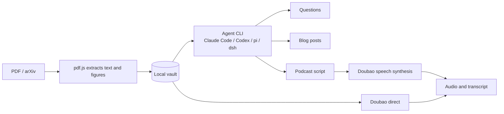

# Wenqu guide

English | [简体中文](guide.zh-CN.md)

The [README](../README.md) shows what Wenqu does. This guide covers how each part works.

## Features

### Workspace

The main area switches between the paper, its blog posts and its podcast episodes. The PDF keeps its place when you switch away. Chat stays alongside all of them, and you can dock it to the side, float it as a panel you can drag and resize, or hide it behind a button.

PDFs are rendered by pdf.js, with search, zoom and a night mode. Math is displayed with KaTeX.

### Chat

The chat beside a paper is the assistant, with that paper open in front of it. It answers from the paper's full text and cites pages, and it can do everything the **Assistant** page can: tag this paper or correct its details, find related work on arXiv and add it to your library, or generate a post or episode. It asks before changing anything, with the same cards as the assistant page.

Conversations are kept per paper. Open the history to return to an earlier one or delete it. They also appear on the **Assistant** page, marked with their paper. Chats from earlier versions move over automatically the first time you open their paper.

After an answer, the agent can offer a few follow-up questions as buttons under it. Clicking one sends it as your next message. They come from the same reply, so they cost no extra model call.

| | When you can change it | Where the options come from |
|---|---|---|
| Harness | Only when creating a chat | The CLIs found on your machine |
| Model | Any time | `codex debug models`, `pi --list-models`, and the aliases in `claude --help` |
| Thinking level | Any time | The CLI's help or model list, per model where it reports them |

Claude Code has no command for listing models, so only the aliases named in its help appear, along with anything in your settings' `model` and `availableModels`. DeepSeek Harness has no such command either, so its models are a fixed list, and you can type another. If `dsh` isn't on your `PATH`, the CLI inside the macOS app is used. Its headless mode doesn't see a key saved in the app, so set `DEEPSEEK_API_KEY` in the environment you start Wenqu from.

The agent settings choose what blog posts and podcast scripts use, and the defaults for new chats.

#### Reading a paper's code

The chat can read a GitHub repository linked to the paper, and compare what the paper says with what the code does.

- **Finding one.** The branch button in the chat bar lists the repositories the paper mentions, from its text and from links hidden behind its text. Papers mention their dependencies and baselines more often than their own code, so the list is ordered by what looks most like this paper's code, and that ordering is only a guess. Check before relying on it. You can also paste any `https://github.com/<owner>/<repo>`.
- **Linking.** Detecting only reads what's on your machine. Nothing touches the network until you click Link. The latest commit of the default branch is fetched in the background, which you can cancel, and the link records that commit. Fetch again to move to a newer one, or unlink to delete the clone once no other paper uses it.
- **Asking.** With the switch on, the agent can list directories, read files and search the code at that commit, without asking first. Each read is listed in the chat as it happens. Answers cite the paper as `[p.N]` and the code with links to those exact lines on GitHub, and they keep pointing at the commit they read. With the switch off or no repository linked, the code tools aren't offered.

### Podcasts

| | Agent script | Doubao direct |
|---|---|---|
| Script comes from | Your local agent | Doubao's summary of the paper |
| Choose language, style and length | Yes | No |
| Edit the script before synthesis | Yes | No |
| Requires an agent | Yes | No |

There are five built-in styles: casual chat, deep dive, debate, beginner-friendly and news brief. You can also describe your own. Synthesis runs in the background, so you can close the page, and an interrupted connection resumes from the last completed turn.

### Blog posts

There are five built-in styles: in-depth explainer, popular science, engineer's view, critical review and short social post. You can also describe your own, and keep editing after generation.

Captioned figures are cropped from the paper automatically, and the agent picks which ones to use. Exported Markdown embeds its images, so one file is all you need to publish.

### Collections

In the library, click **Make collection**, select 2 to 12 papers, then choose a format:

- **Weekly digest:** covers the papers one at a time, as a single episode or post.
- **Mini review:** organizes by theme and compares methods and evidence across papers.

Citations show which paper and page each claim came from.

### Tags

Tags group papers by whatever you care about, and the row above the shelf filters by them. Choosing several narrows the list to papers that have them all, **No tags** shows what you haven't got to, and clicking a tag on a card works too.

- **By hand:** open a paper and click the tag icon in the top bar.
- **With an agent:** the same panel has **Generate with agent**, which adds a few tags from the paper's title, abstract and opening pages. It reuses tags you already have where they fit.
- **When adding a paper:** turn on **Generate tags with the agent when adding papers** in the add-paper dialog or under **Settings → General**. It's off by default, and it covers dropped files too.
- **Through the assistant:** ask it to tag your untagged papers, or to clean up the tags on a topic. Tags it wants to give a paper it adds from arXiv appear on the same card you approve.

Tags that differ only in case count as one, so `llm` takes the spelling already in your library.

### Assistant

Open **Assistant** in the top bar. It works across your entire library; the chat beside a paper is the same assistant, starting from that paper. Try:

- "Find three recent papers related to the one I added last, and add the best one."
- "Which papers don't have a podcast yet? Write a short script for each."
- "The authors on this paper are wrong. They should be…"

Nothing happens to your library without you. Each request shows up as a card written by the app, not by the agent, listing exactly what will happen, including the old and new values of an edit. A batch needs one approval, and you can untick any part of it. You can also change a generation's style, language and length right on the card. Cards stay open while you keep talking, so you can ask about one before deciding. If an approved action fails or is interrupted, **Retry** runs it again as approved.

| Action | Approval |
|---|---|
| Add, edit, tag or delete a paper; create a collection | Always |
| Generate a podcast or blog post; synthesize audio | Always |
| Read or search a paper's full text | By default. You can allow it for one chat or always, and change that under **Settings → Assistant** |
| See titles, authors, abstracts, tags, collections and what's been generated | Not needed |
| Search arXiv | Not needed, because it changes nothing |

Results from an arXiv search can also be added with their own **Add** button. The assistant can add papers from arXiv only, so use **Add paper** for local PDFs. To stop a batch, press stop in the chat, which also stops any generation it started.

When a turn is finished and nothing is waiting for approval, the assistant can offer a few next steps as buttons under its reply. Clicking one sends it as your next message and nothing more, so any change it leads to still needs your approval.

### Notifications

Blog posts, scripts, audio and the assistant all run in the background. Turn on **Settings → General → Send a browser notification when a task finishes**, or accept the offer shown when your first task starts, and the browser tells you when a task finishes or fails, or when the assistant is waiting for your approval. Clicking the notification opens the result.

If you are looking at the page, you get a short message inside it instead, and no message when a task succeeds on the result's page you're already on. A failed blog post, script or audio run always shows one. A notification shows the task's label, which usually includes the paper's title, so that text is visible on your screen and in your system's notification history.

The permission belongs to the browser and to the exact address, port included. If 4317 is taken and Wenqu moves to another port, or you open `localhost` instead of `127.0.0.1`, you need to allow it again.

## Updating

When `origin/main` has new commits, a bar at the top of the page offers **Update and restart**: it pulls, reinstalls, rebuilds and reloads the page. It explains itself instead if you have local changes, are on another branch, or are running `npm run dev`.

## Command line

```text
wenqu [start] [--vault <dir>] [--port <n>] [--no-open]       Start the server and open a browser
wenqu add <file.pdf|arXiv link or id...> [--vault <dir>]     Import papers
```

```bash
wenqu add paper.pdf https://arxiv.org/abs/1706.03762 2005.14165
```

## Configuration

Settings are stored in `~/.config/wenqu/config.json` (mode 600). You will normally change them in the settings panel. Text size is under **Settings → General**, and doesn't affect the PDF, which has its own zoom. Command-line messages follow your terminal's language (`LANG`) unless you have chosen an interface language in Settings.

| Environment variable | Purpose |
|---|---|
| `DOUBAO_API_KEY` | Doubao API key; takes precedence over the config file |
| `WENQU_CONFIG_DIR` | Location of the config directory |
| `NODE_USE_ENV_PROXY=1` with `HTTPS_PROXY` | Send arXiv downloads through a proxy (Node 24 or later) |

## Your data

The vault lives in `~/Wenqu` by default. Its contents remain usable without this tool:

```text
<vault>/
  papers/<paper-id>/
    paper.pdf
    meta.json         Title, authors, tags, linked repository and so on; safe to edit by hand
    text.json         Extracted text, page by page
    thumb.jpg         Cover image, with cover.json recording how it was chosen
    repo-links.json   GitHub links read from the PDF, a cache
    figures/          Extracted figures
    blogs/<id>.md     Front matter + Markdown, with figures as relative paths
    podcasts/<id>/    podcast.json (script and timeline), audio.mp3
  collections/<collection-id>/
    collection.json   Name and list of papers
    blogs/  podcasts/
  assistant/<id>.json One file per assistant conversation, including chats beside a paper
  .trash/             Deleted items move here and are not permanently removed
```

Your API key is not stored in the vault, so syncing or sharing a vault does not expose it.

Clones of linked repositories stay out of the vault too, in `~/.config/wenqu/repos`. If a clone is missing, as on a new machine, the recorded commit is fetched again the next time you ask. If that fails, the answer says so and uses the paper alone.

The project was first called Paper2Podcast. Settings in `~/.config/paper2podcast` are copied over the first time Wenqu starts, and a vault at `~/Paper2Podcast` keeps being used. You can delete the old config folder afterwards.

## How it works



Paper content is sent to the agent service you choose, and so are the parts of a linked repository the agent reads. When generating audio, the script or paper text is sent to Doubao. Everything else stays on your machine.

## Security

- **Local only.** The server listens on `127.0.0.1` and rejects requests from other Hosts and Origins, so malicious websites can't reach it through your browser.
- **Papers are untrusted data.** A PDF may contain prompt injection, so agents run in an empty temporary directory. Claude Code, pi and DeepSeek Harness have all tools disabled, and Codex uses a read-only sandbox. Codex has no option to disable tools completely, so it can still read local files, but it can't write to them and has no network access by default.
- **The assistant can only ask.** Its agent has no tools either. It writes down what it wants to do, and the server checks the request, describes it to you from the app's own data, and runs only what you approve. A paper with hidden instructions can at most put a request in front of you, so read the card before approving. Your library's details go to the agent service without asking. Searching arXiv doesn't ask first either, so a query could carry a little text from something the assistant has read; every query is shown in the chat, and it can only go to arXiv.
- **Repositories are untrusted too.** A linked repository is only fetched when you click, only from `https://github.com/<owner>/<repo>` with both parts strictly checked, and never with a shell. Clones are bare, with no working tree, so its symlinks and hooks can't do anything, and files are read out of git's object store. The agent has no shell or real tools: it can only ask the server to list, read or search that one repository at that one commit, and it can't choose another repository or a URL. Results reach it marked as data, but a README addressed to an AI can still sway its answer, so treat answers with the same care as the repository itself. What it reads goes to your agent service, so don't link anything you wouldn't send there. Your git settings still apply, so a private repository your git can reach can be linked.
- **Output is sanitized.** Agent output passes through DOMPurify before rendering, and only the app's own images load, which stops content from leaking through remote image URLs.
- **Imports are restricted.** arXiv import only downloads from `arxiv.org`, and never fetches arbitrary URLs.

If you find a security issue, please contact the maintainers privately instead of disclosing it publicly.

## Known limitations

- **Platforms:** developed and tested only on macOS with Node 26. Windows and Linux are unverified.
- **Voices:** Doubao's podcast voices are Chinese voices. English and Japanese can be synthesized, but listen to a sample before relying on them.
- **Length:** Doubao allows 300 characters per turn and 10,000 in total. At typical speaking rates, that is about 35 minutes in Chinese but only about 12 in English.
- **Scanned PDFs:** AI features don't work yet on PDFs without a text layer.
- **Long papers:** agents receive up to 150,000 characters (shared evenly across a collection), and Doubao direct receives up to 20,000.
- **Figures:**
  - Only captions in the style of `Figure N:` are detected, and tables aren't extracted. You can remove a bad crop in the blog form.
  - Agents can't see the images, so they choose and describe figures from their captions alone.
  - Extraction relies on the optional `@napi-rs/canvas` package. Where it isn't supported, blog posts have no figures, and a paper's cover is the whole page holding its first figure rather than a crop.
- **Collections:** agent scripts only, with no chat.
- **Notifications:** they come from the open page, so the tab has to stay open: a closed tab gets none, and neither does a tab the browser has unloaded to save memory. Tasks keep running either way, and the result is there when you come back. They also need a secure address such as `127.0.0.1`, and Android browsers don't show them.
- **Reading code:**
  - Only in the chat beside a paper, GitHub only, and only the default branch's latest commit, so the code may be newer than the paper. Tags, other branches, submodules and Git LFS files aren't available.
  - The agent only reads the code. It runs nothing, so it can't confirm that the code behaves as written or reproduces the paper's results.
  - Detection can miss a repository, for example when a line break in the PDF loses a hyphen in its name, and can rank a dependency first. Repositories over 500 MB aren't fetched.
  - Each question gets up to 8 steps, and each step starts the CLI again, so these answers are slower and use more of your agent quota. Citations can't link to a path containing `[` or `]`.
- **Assistant:** finds and adds papers on arXiv only, can't add local PDFs itself, and has no notion of citations between papers, so "related" comes from keyword search. Each step starts its CLI again, so long conversations are slow and use more of your agent quota.

AI-generated content can be wrong, so check it against the source before publishing. Before reusing a paper's text or figures, also confirm what its license allows.

## Development

```bash
npm install
npm run dev         # Server on 4317 + Vite on 5173; open http://localhost:5173
npm test            # No external network access and no API usage
npm run typecheck
```

Please make sure `npm test` and `npm run typecheck` both pass before submitting.

```text
src/server/   CLI, Express server, vault, agent adapters, Doubao protocol, arXiv, figure extraction
src/shared/   Types and presets shared by server and client
web/src/      React frontend
tests/        Unit tests and test PDFs
docs/         Screenshots and protocol notes
```

**Adding interface text:** wrap it in `t()` and add its English entry to `src/shared/i18n.ts`. The Chinese text is the key, so a missing translation is a type error, and a test catches any text left outside `t()`.

**Adding an agent backend:** add an entry to `ADAPTERS` in `src/server/agents.ts`, with its launch arguments and how to parse text from its JSON output. Make sure it can't act on instructions found in a paper.

**Working on the Doubao integration:** the official docs differ from the service's actual behavior in several places. See the [protocol notes](doubao-protocol.md) (in Chinese).

## Acknowledgements

- [pdf.js](https://github.com/mozilla/pdf.js): PDF rendering and text extraction
- [KaTeX](https://github.com/KaTeX/KaTeX): math display
- [marked](https://github.com/markedjs/marked) and [DOMPurify](https://github.com/cure53/DOMPurify): Markdown rendering and sanitization
- [@napi-rs/canvas](https://github.com/Brooooooklyn/canvas): server-side PDF page rendering
- [arXiv](https://arxiv.org/): thank you for open access to its API
- [Doubao Speech](https://www.volcengine.com/): podcast synthesis

This is an independent open-source project, not affiliated with Anthropic, OpenAI, Volcengine or arXiv. Use of those services is subject to their own terms, and they bill for usage separately.
