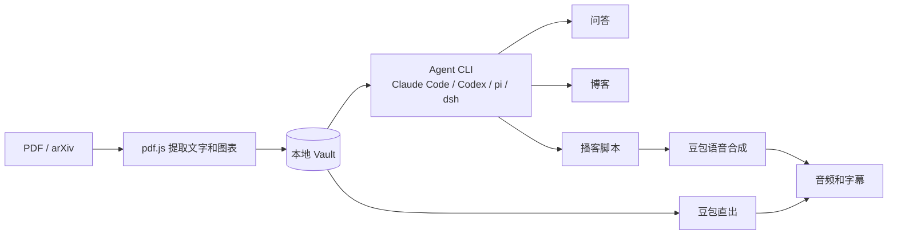

# 问渠使用手册

[English](guide.md) | 简体中文

[README](../README.zh-CN.md) 介绍问渠能做什么，这份手册说明每个部分具体怎么用。

## 功能

### 工作区

主屏幕在论文、博客和播客之间切换，切走再回来时 PDF 还停在原来的位置。问答始终在一旁，可以停靠在侧边、悬浮成可拖动和调整大小的面板，也可以收起成一个按钮。

PDF 由 pdf.js 渲染，支持搜索、缩放和夜读。数学公式用 KaTeX 显示。

### 问答

论文旁边的问答就是助手，只是面前摊开着这篇论文。它根据全文回答并标注页码，也能做**助手**页能做的一切：给这篇论文打标签或修改信息、在 arXiv 上找相近的工作并加入书架、生成博客或播客。改动之前会先征得你的同意，审批卡片和助手页一样。

会话按论文保存。打开历史可以回到之前的会话或删除它。这些会话也会出现在**助手**页，并标出对应的论文。旧版本的问答会在第一次打开对应论文时自动迁移过来。

回答之后，Agent 可以在下方给出几个后续问题的按钮，点击就会作为你的下一条消息发送。它们和回答出自同一次回复，不会多调用一次模型。

| | 什么时候能改 | 选项从哪里来 |
|---|---|---|
| Harness | 只有新建会话时 | 本机检测到的 CLI |
| 模型 | 随时 | `codex debug models`、`pi --list-models` 和 `claude --help` 里的别名 |
| 思考强度 | 随时 | CLI 的帮助或模型列表，能按模型区分的就按模型区分 |

Claude Code 没有列出模型的命令，所以只显示帮助里提到的别名，以及设置中 `model` 和 `availableModels` 的内容。DeepSeek Harness 同样没有这个命令，所以它的模型是固定列表，也可以手动输入其他模型。如果 `PATH` 上没有 `dsh`，会使用 macOS 应用内的 CLI。它的 headless 模式读不到保存在应用里的 key，所以需要在启动问渠的环境里设置 `DEEPSEEK_API_KEY`。

Agent 设置决定博客和播客脚本用什么，也是新建问答的默认值。

#### 阅读论文的代码

问答可以读取关联到这篇论文的 GitHub 仓库，对照论文的说法和代码的实际做法。

- **找到仓库。** 问答栏里的分支按钮会列出论文提到的仓库，来源包括正文，以及藏在文字背后的链接。论文提到依赖和基线的次数往往多于自己的代码，所以列表按“看起来最像这篇论文的代码”排序，但这只是猜测，请先确认。也可以粘贴任意 `https://github.com/<owner>/<repo>`。
- **关联。** 检测只读取本机已有的内容，点击“关联”之前不会访问网络。关联时会在后台拉取默认分支的最新提交，可以随时取消，并记录这个提交。想更新就再拉取一次；取消关联后，如果没有其他论文在用，克隆也会删除。
- **提问。** 打开开关后，Agent 可以在这个提交上列出目录、读取文件和搜索代码，不需要先征得同意。每次读取都会列在问答里。回答用 `[p.N]` 引用论文，用链接引用代码，点击会跳到 GitHub 上对应的行，并且始终指向它读过的那个提交。关闭开关或没有关联仓库时，不提供读代码的工具。

### 播客

| | Agent 写稿 | 豆包直出 |
|---|---|---|
| 脚本来源 | 本机 Agent | 豆包总结论文 |
| 选择语言、风格、时长 | 支持 | 不支持 |
| 合成前修改脚本 | 支持 | 不支持 |
| 需要 Agent | 需要 | 不需要 |

内置 5 种风格：轻松对谈、深度解析、观点交锋、零基础科普、快讯简报，也可以自己描述。合成在后台进行，关闭页面不受影响，连接中断时会从最后完成的一轮续传。

### 博客

内置 5 种风格：深度解读、通俗科普、工程师视角、批判性评论、社交媒体短文，也可以自己描述。生成后可以继续编辑。

带图注的图表会自动从论文里裁出来，由 Agent 挑选插入。导出的 Markdown 内嵌图片，一个文件就能发布。

### 合集

在书架点「做合集」，选 2 到 12 篇论文，然后选择形式：

- **本周论文**：逐篇讲，串成一期。
- **小型综述**：按主题组织，比较各篇的方法和证据。

引用会标明出自哪篇的哪一页。

### 标签

标签按你关心的方式给论文分组，书架上方的那一行可以按标签筛选。选中多个时，只显示同时有这些标签的论文；**无标签**显示还没整理的论文；点卡片上的标签也能筛选。

- **手动：** 打开论文，点顶栏的标签图标。
- **用 Agent：** 同一个面板里有**用 Agent 生成**，会根据论文的标题、摘要和开头部分加上几个标签，并尽量沿用你已有的标签。
- **添加论文时：** 在添加论文的窗口或**设置 → 通用**里打开**添加论文时用 Agent 生成标签**。默认关闭，打开后拖进来的文件也会生成。
- **通过助手：** 让它给还没有标签的论文打标签，或者整理某个主题的标签。它从 arXiv 添加论文时想加的标签，会写在你批准的同一张卡片上。

只有大小写不同的标签算作同一个，所以 `llm` 会沿用书架里已有的写法。

### 助手

点击顶部的**助手**。它面向整个书架；论文旁边的问答是同一个助手，只是从那篇论文出发。可以这样用：

- “找三篇和我最近添加的论文相近的新论文，把最好的一篇加进来。”
- “哪些论文还没有播客？给每篇写一个短脚本。”
- “这篇论文的作者写错了，应该是……”

未经你同意，书架不会有任何变化。每个请求都会显示成一张卡片，内容由应用而不是 Agent 撰写，列明具体会做什么，修改操作还会显示新旧值。一批操作只需批准一次，也可以取消勾选其中的任意几项。生成内容的风格、语言和长度可以直接在卡片上修改。继续对话时卡片会保留，你可以先问清楚再决定。已批准的操作如果失败或被中断，点**重试**会按批准时的内容再次执行。

| 操作 | 是否需要批准 |
|---|---|
| 添加、修改、删除论文或给论文打标签，创建合集 | 始终需要 |
| 生成播客或博客，合成音频 | 始终需要 |
| 读取或搜索论文全文 | 默认需要。可以在单个会话里允许，也可以一直允许，并在**设置 → 助手**里更改 |
| 查看标题、作者、摘要、标签、合集和已生成的内容 | 不需要 |
| 搜索 arXiv | 不需要，因为它不会改变任何内容 |

arXiv 搜索结果也可以用各自的**添加**按钮加入书架。助手只能从 arXiv 添加论文，本地 PDF 请用**添加论文**。要中止一批操作，在聊天里点停止，由它启动的生成任务也会一起停止。

一轮结束、没有等待批准的操作时，助手可以在回复下方给出几个下一步的按钮。点击只是把它作为你的下一条消息发送，由此引起的任何改动仍然需要你批准。

### 通知

博客、脚本、音频和助手都在后台运行。打开**设置 → 通用 → 任务完成时发送浏览器通知**，或者在第一个任务开始时接受页面上的提示，任务完成或失败、助手等待你批准时，浏览器就会提醒你。点击通知会打开对应的结果。

如果你正看着页面，提醒会变成页面里的一条短消息；如果任务成功时你已经停留在结果所在的页面，则不再提醒。博客、脚本或音频失败时一定会提示。通知会显示任务名称，其中通常包含论文标题，这些文字会出现在屏幕和系统的通知记录里。

通知权限属于浏览器和具体地址，包括端口。如果 4317 被占用、问渠换了端口，或者用 `localhost` 代替 `127.0.0.1` 打开，需要重新允许一次。

## 更新

`origin/main` 有新提交时，页面顶部会出现提示和**更新并重启**按钮，点击后会拉取代码、重新安装、重新构建并刷新页面。如果本地有改动、不在 main 分支，或正在运行 `npm run dev`，则只说明无法更新的原因。

## 命令行

```text
wenqu [start] [--vault <dir>] [--port <n>] [--no-open]   启动服务并打开浏览器
wenqu add <file.pdf|arXiv 链接或编号...> [--vault <dir>]  导入论文
```

```bash
wenqu add paper.pdf https://arxiv.org/abs/1706.03762 2005.14165
```

## 配置

配置保存在 `~/.config/wenqu/config.json`（权限 600），一般在设置面板里修改即可。字体大小在「设置 → 通用」里调整，不影响 PDF，PDF 有自己的缩放。命令行提示跟随终端语言（`LANG`），在设置里指定界面语言后则以设置为准。

| 环境变量 | 作用 |
|---|---|
| `DOUBAO_API_KEY` | 豆包 API Key，优先级高于配置文件 |
| `WENQU_CONFIG_DIR` | 配置目录的位置 |
| `NODE_USE_ENV_PROXY=1` 和 `HTTPS_PROXY` | 让 arXiv 下载走代理（需要 Node 24 及以上） |

## 数据存放

Vault 默认位于 `~/Wenqu`。即使不用这个工具，里面的内容也能直接打开：

```text
<vault>/
  papers/<paper-id>/
    paper.pdf
    meta.json         标题、作者、标签、关联的仓库等，可以手动修改
    text.json         提取的逐页文字
    thumb.jpg         封面图，cover.json 记录它是怎么选出来的
    repo-links.json   从 PDF 读到的 GitHub 链接（缓存）
    figures/          提取的图表
    blogs/<id>.md     front matter + Markdown，图片用相对路径引用
    podcasts/<id>/    podcast.json（脚本和时间轴）、audio.mp3
  collections/<collection-id>/
    collection.json   名称和论文列表
    blogs/  podcasts/
  assistant/<id>.json 每个助手会话一个文件，包括论文旁边的问答
  .trash/             删除的内容会移到这里，不会真正删除
```

API Key 不在 Vault 中，所以同步或分享 Vault 不会泄露 Key。

关联仓库的克隆同样不在 Vault 中，而是放在 `~/.config/wenqu/repos`。如果克隆不见了（比如换了一台电脑），下次提问时会重新拉取记录的提交；拉取失败时，回答会说明这一点，并且只依据论文。

这个项目最早叫 Paper2Podcast。首次启动时会把 `~/.config/paper2podcast` 里的设置复制过来；如果 Vault 在 `~/Paper2Podcast`，也会继续使用。之后可以自行删除旧的配置目录。

## 工作原理



论文内容以及 Agent 读取的那部分关联仓库内容，会发送给你选择的 Agent 服务；生成音频时，脚本或论文文字会发送给豆包语音。其余内容都留在本机。

## 安全

- **只面向本机。** 服务只监听 `127.0.0.1`，并拒绝来自其他 Host 或 Origin 的请求，恶意网页无法借助你的浏览器访问它。
- **论文是不可信数据。** PDF 里可能藏着提示注入，所以 Agent 在空的临时目录中运行：Claude Code、pi 和 DeepSeek Harness 禁用所有工具，Codex 使用只读沙箱。Codex 没有完全禁用工具的选项，它仍可读取本机文件，但不能写入，默认也不能联网。
- **助手只能提出请求。** 它的 Agent 同样没有任何工具，只能写下想做的事；服务端会检查请求，用应用自己的数据向你说明，并且只执行你批准的操作。藏有恶意指令的论文最多只能把一个请求摆到你面前，所以批准前请看清卡片。书架的书目信息会直接发送给 Agent 服务，不会询问。搜索 arXiv 也不需要批准，因此查询词可能带上助手读过的少量文字；每次查询都会显示在聊天里，而且只会发给 arXiv。
- **仓库同样不可信。** 关联的仓库只在你点击时拉取，只接受严格校验过的 `https://github.com/<owner>/<repo>`，也不经过 shell。克隆是不带工作区的 bare 仓库，其中的符号链接和钩子不起作用，文件直接从 git 的对象库读取。Agent 没有 shell，也没有真正的工具，只能请服务端在这一个仓库的这一个提交上列出、读取或搜索，不能指定其他仓库或网址。读到的内容会标记为数据，但写给 AI 看的 README 仍可能影响回答，所以请像对待仓库本身一样审慎看待回答。Agent 读到的内容会发送给你的 Agent 服务，所以不要关联不便发送的内容。你的 git 设置依然生效，因此你的 git 能访问的私有仓库也可以关联。
- **输出经过清理。** Agent 的输出在渲染前会经过 DOMPurify 处理，并且只加载应用自己的图片，防止内容通过远程图片地址被发送出去。
- **导入范围受限。** arXiv 导入只从 `arxiv.org` 下载，不会抓取任意网址。

发现安全问题时，请私下联系维护者，不要直接公开。

## 已知限制

- **平台：** 目前只在 macOS 和 Node 26 上开发测试过，Windows 和 Linux 尚未验证。
- **音色：** 豆包的播客音色都是中文音色。英文和日文可以合成，但发音效果请先试听。
- **长度：** 豆包限制每轮 300 字符、全文 10,000 字符。按语速估算，中文约 35 分钟，英文只有约 12 分钟。
- **扫描件：** 没有文字层的 PDF 暂时无法使用 AI 功能。
- **长论文：** 发送给 Agent 的文字上限为 150,000 字符（合集由各篇平分），豆包直出为 20,000 字符。
- **图表：**
  - 只识别 `Figure N:` 这类图注，表格不提取。裁剪不对的可以在博客表单里移除。
  - Agent 看不到图片，只能根据图注挑选和描述。
  - 图表提取依赖可选的 `@napi-rs/canvas`，平台不支持时博客不带图，论文封面也会用第一张图所在的整页，而不是裁剪后的图。
- **合集：** 只能用 Agent 写稿，也没有问答。
- **通知：** 通知由打开的页面发出，所以标签页必须保持打开：关闭的标签页收不到，被浏览器为节省内存而卸载的标签页也收不到。任务本身不受影响，回来时结果仍在。另外，通知需要 `127.0.0.1` 这样的安全地址，Android 浏览器不会显示。
- **阅读代码：**
  - 只在论文旁边的问答里可用，只支持 GitHub，也只拉取默认分支的最新提交，所以代码可能比论文新。标签、其他分支、子模块和 Git LFS 文件都不可用。
  - Agent 只读代码，不运行任何东西，所以无法确认代码的实际行为，也无法复现论文的结果。
  - 检测可能漏掉仓库（比如 PDF 换行时丢了名字里的连字符），也可能把依赖排在第一。超过 500 MB 的仓库不会拉取。
  - 每个问题最多 8 步，每一步都要重新启动 CLI，所以这类回答更慢，也更耗 Agent 额度。路径里带 `[` 或 `]` 的文件无法生成引用链接。
- **助手：** 只能在 arXiv 上查找和添加论文，不能自己添加本地 PDF；也不了解论文之间的引用关系，“相近”来自关键词搜索。每一步都要重新启动 CLI，所以长对话较慢，也更耗 Agent 额度。

AI 生成的内容可能有错，发布前请对照原文核对。转载论文的文字和图表前，也请确认原论文的授权范围。

## 开发

```bash
npm install
npm run dev         # 服务端 4317 + Vite 5173，打开 http://localhost:5173
npm test            # 不访问网络，也不消耗 API 额度
npm run typecheck
```

提交前请确认 `npm test` 和 `npm run typecheck` 都能通过。

```text
src/server/   命令行、Express 服务、Vault、Agent 适配、豆包协议、arXiv、图表提取
src/shared/   前后端共用的类型和预设
web/src/      React 前端
tests/        单元测试和测试用 PDF
docs/         截图和协议笔记
```

**新增界面文案：** 用 `t()` 包裹文案，并在 `src/shared/i18n.ts` 里加上英文。中文原文就是键，缺少翻译会报类型错误，还有测试检查是否有文案漏在 `t()` 之外。

**新增 Agent 后端：** 在 `src/server/agents.ts` 的 `ADAPTERS` 中加一项，写明启动参数，以及如何从 JSON 输出中解析文字。请确保它运行时不能执行论文里的指令。

**接入豆包协议：** 官方文档与实际行为有几处出入，见[实测笔记](doubao-protocol.md)。

## 致谢

- [pdf.js](https://github.com/mozilla/pdf.js)：PDF 渲染和文字提取
- [KaTeX](https://github.com/KaTeX/KaTeX)：公式显示
- [marked](https://github.com/markedjs/marked) 和 [DOMPurify](https://github.com/cure53/DOMPurify)：Markdown 渲染和内容清理
- [@napi-rs/canvas](https://github.com/Brooooooklyn/canvas)：服务端渲染 PDF 页面
- [arXiv](https://arxiv.org/)：感谢 arXiv 提供开放访问接口
- [豆包语音](https://www.volcengine.com/)：播客合成

本项目是独立的开源项目，与 Anthropic、OpenAI、火山引擎和 arXiv 没有关联。使用这些服务时，请遵守各自的条款，相关费用也由这些服务另行收取。
